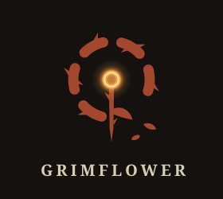

# Grimflower

This project exists out of both my fascination with quake and quake derived game engines, and my frustrations with how the various tools in those engines (and in most big engines too for that matter) are designed.

I'm someone who thinks a lot about the process of using any kind of tool, whether it be blender or just a simple sprite editor. To me there's a facet of creativity that is enhanced when the tool being used in that process is intuitive, even if it's intuitive in an uncommon way (see also: Quake Level Editors). So for a while now i've dealt with this thing of wanting to use and find more of those tools, tools that make development more enjoyable and less frustrating.

This project Follows up on that idea, it's going to be a very basic quake clone, but alongside it will be the building blocks for what i hope to be the engine i use for all my 3d games in the future

## Building

The project is at a very early stage and as a result i've not done anything to support building on other platforms. If you'd like to figure that out yourself and if it works you can add a PR for it.

### Requirements (Windows)

- Windows 10 or 11, 64-bit
- [Visual Studio 2022 or newer](https://visualstudio.microsoft.com/) (the free Community edition works, or just the Build Tools) with the **Desktop development with C++** workload, which includes the MSVC compiler and the Windows SDK
- [Git](https://git-scm.com/), to clone the repo

### Libraries

Everything the game and editor use is already in `vendor/`, so there's nothing else to download or install:

| Library | Version | Used for |
| --- | --- | --- |
| [raylib](https://www.raylib.com/) | 6.0 | Window, input, rendering and audio. Prebuilt static library for MSVC x64 |
| [raygui](https://github.com/raysan5/raygui) | 5.1-dev | The editor's UI. Header-only |
| [nlohmann/json](https://github.com/nlohmann/json) | 3.12.0 | Reading and writing level files. Header-only |
| [miniz](https://github.com/richgel999/miniz) | 11.3.2 | Reading assets from `gamedata.zip`. Compiled in with the game and editor |
| [assimp](https://github.com/assimp/assimp) | 6.0.5 | Reading model files. Prebuilt static library for MSVC x64, with only the importers we use |
| [stb_image](https://github.com/nothings/stb) | 2.30 | Image loading. Header-only |

They also link against these Windows system libraries, which come with the Windows SDK: `opengl32`, `gdi32`, `winmm`, `user32` and `shell32`, plus `comdlg32` for the editor's Open/Save dialogs.

### Testing

Run `tests\run_tests.bat`. It builds the project, then runs `tests/geometry_test.cpp`, which drives the editor's real code in a hidden window. GitHub Actions runs the same script on every push to `master` and every pull request (`.github/workflows/tests.yml`), with Mesa's software OpenGL because its runners have no GPU.

### Compiling

1. Clone the repo:
   ```
   git clone https://gitlab.com/null-group4204540/grimflower.git
   cd grimflower
   ```
2. Run `build.bat`, either by double-clicking it or from a terminal. It works from a plain Command Prompt or PowerShell. If `cl.exe` isn't already on your PATH, it finds your Visual Studio install and sets up the 64-bit compiler itself.

`build.bat` then:

1. Compiles the icon, `icon.ico`, which both programs use. It's rendered from `icon.svg`: run `tools/make_icon.ps1` after changing that file
2. Compiles every `.cpp` in `src/game/`, `src/engine/` and `src/shared/` into `build/grimflower.exe`
3. Runs `grimflower.exe -exportentities` to write `entitylist.txt`, the list of entity types the editor reads
4. Compiles every `.cpp` in `src/editor/`, `src/engine/` and `src/shared/` into `build/GrimEd.exe`
5. Packs `cfg/`, `maps/`, `models/` and `textures/` into `build/gamedata.zip`

Everything it makes goes in `build/`. There are no build settings to change. New `.cpp` files in any of these folders are picked up automatically. The source is split into:

- `src/engine/`: the engine, which knows nothing about the game: rendering, the world and its collision, game data, the console, cvars, commands and key binds
- `src/game/`: the game: the player, entities, menus, and its own console commands
- `src/editor/`: the level editor
- `src/shared/`: what the editor shares with the game or the engine, like the level file format

### Running

- **Game:** run `build\grimflower.exe`. Play loads `maps/dev.json`. When the game is inside the project folder, it loads files straight from `maps/`, `models/`, `textures/` and `cfg/`, so edits show up without rebuilding. Otherwise it reads them from `gamedata.zip` next to it.
- **Editor:** run `build\GrimEd.exe`. It needs to be inside the project folder, since it looks for `maps/` and `models/` in its own folder and up to three folders above it. It also needs the `entitylist.txt` written by `build.bat`, so run the build after adding or changing entity types in `src/game/entities.cpp`.

Both write their settings and logs next to the executable (`config.cfg`, `editor.cfg` and `console.log`). Those files are ignored by git.

# AI Disclaimer

This project primarily uses AI to write most of the code, this is a hobby project done by someone who would consider themselves more of an artist than a programmer. There is no AI art or any other type of generative AI use other than for programming purposes.

# Early Development Disclaimer

A lot of the things used for this are still very much in development and i have no idea how much is left until i can confidently say there'll be no breaking changes. The level editor especially is the one tha might break the most between different builds and different iterations on the JSON map format. If you have any questions please feel free to add them here and i'll try my best to get to them.

I've gone and build a roadmap to keep track of how far the project is from the V1 release. though there is still no release date

Thank you for your time